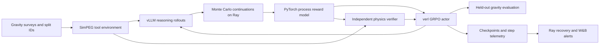

# GeoTrace-RL: Process Rewards for Geophysical Reasoning

GeoTrace-RL trains process rewards for gravity-inversion reasoning: a policy proposes a source model, calls a forward simulator, and receives feedback on whether its reasoning prefix can still lead to a successful prediction. Monte Carlo continuation labels supervise a PyTorch reward head. Independent physics checks constrain the reward before GRPO policy updates. The aim is to stop flawed reasoning early while keeping the simulator, learned reward, and final geological evaluation separate.

## Architecture



Survey identity defines train, validation, and test membership before traces are built. The main path learns from textual reasoning/tool prefixes. A smaller feature MLP and an analytic point-mass environment make CPU checks inexpensive. Both the finite-cube SimPEG environment and the point-mass environment feed the same labeling and verification interfaces.

GRPO standardizes rewards within each prompt's sampled group and removes PPO's learned critic. This reduces model-state memory at the cost of several rollouts per prompt and sensitivity to groups with little reward variation. vLLM supplies rollout inference. verl owns actor optimization, reference-policy KL, sharding, and native checkpoint restoration.

Physics checks recompute simulator outputs before a learned score can affect the actor. This costs forward solves but closes the direct path from invented tool results to high rewards. The custom agent preserves sampled token IDs and masks observation tokens from policy loss. Its step scores are aggregated into one rollout reward. The ledger keeps checkpoint progress separate from work that must be repeated after an interruption. [Architecture and failure contracts](docs/ARCHITECTURE.md) cover these boundaries.

## Results

[Metric definitions and measurement paths](benchmarks/reference.json) accompany the results below.

| Metric | Value | Context |
| --- | --- | --- |
| Process-label scale | 140K reasoning steps | Monte Carlo labels of SimPEG tool calls over public gravity surveys trained the process reward model. |
| First-error F1 | 0.58 → 0.81 | Earlier detection supports pruning flawed reasoning traces. |
| Training hardware | 8 A100 GPUs | verl and vLLM rollout workers share the policy-training node. |
| VRAM reduction | 35% | Group-relative advantages remove the PPO critic under a matched workload. |
| Policy scale and placement | 7B parameters, one node | The reduced training footprint fits the policy run on one node. |
| Reward-hacking frequency | 23% → 4% of rollouts | Physics consistency checks and KL-anchored clipped rewards reduce independently failed high-reward outputs. |
| Held-out gravity prediction error | 29% lower | Comparison against outcome-only RL on held-out observations. |
| Interrupted spot-GPU jobs restored | 11 jobs | Ray checkpoint recovery restores interrupted experiments. |
| Lost runs | 0 | Restored experiments retain their durable run identity and state. |
| Usable GPU hours | 96% per experiment | Experiment-level useful GPU-time accounting, distinct from the ledger's committed-step fraction. |

## Tech Stack

Exact direct pins live in [requirements/](requirements/README.md). The CPU and Linux/CUDA profiles are separate environments.

| Tool or method | CPU checks / CUDA research profile | Role |
| --- | --- | --- |
| Python | 3.12 / 3.11 | Local validation and pinned distributed runtime. |
| PyTorch | 2.8.0 CPU / 2.6.0 | Feature and transformer reward heads, optimizer and RNG checkpoints. |
| verl | CUDA: 0.5.0 | GRPO/PPO training, FSDP workers, reference-policy KL and checkpoint resume. |
| GRPO and PPO | Algorithms | Critic-free group-relative estimator and matched critic-based baseline. |
| vLLM | CUDA: 0.8.5 | Tool-capable model serving and token rollout workers. |
| Ray | 2.45.0 | Parallel continuation labels and explicit worker-loss recovery. |
| SimPEG / discretize | 0.24.0 / 0.11.3 | Finite-cube gravity integrals and general mesh adapter. |
| Transformers | 4.56.0 / 4.51.3 | Textual prefix classifier, Trainer checkpoints and early stopping. |
| Weights & Biases | 0.21.3 / 0.19.11 | Optional experiment tracking and step/worker alerts. |
| NumPy | 2.2.6 / 1.26.4 | Finite-grid baseline, Monte Carlo sampling and objective checks. |
| Monte Carlo / reward clipping / KL regularization | Methods | Continuation probabilities, Wilson intervals, bounded rewards and actor KL. |

## Getting Started

Use Python 3.12 for the complete locally checked CPU profile. The NumPy-only demo also supports Python 3.11 through the version markers in package metadata. GNU Make is optional. Each recipe is an ordinary Python command.

```bash
python -m venv .venv
# Linux/macOS
source .venv/bin/activate
# Windows PowerShell instead: .venv\Scripts\Activate.ps1
python -m pip install torch==2.8.0 --index-url https://download.pytorch.org/whl/cpu
python -m pip install -r requirements/cpu.txt -r requirements/dev.txt
python -m pip install -e . --no-deps
make check
```

Without Make:

```bash
python -m ruff check .
python -m ruff format --check .
python -m mypy geotrace monitoring scripts
python -m pytest tests -q
python scripts/generate_sample_data.py --output outputs/sample-traces.jsonl
python -m geotrace.demo --output outputs/demo.json
```

A small train/evaluate run uses synthetic, survey-disjoint finite-grid data:

```bash
python -m geotrace.data generate --surveys 10 --output outputs/surveys.jsonl
python -m geotrace.data label --input outputs/surveys.jsonl --samples 16 --output outputs/labels.jsonl
python -m geotrace.train_prm --input outputs/labels.jsonl --output outputs/prm --epochs 2 --synthetic
python -m geotrace.evaluate_prm --input outputs/labels.jsonl --checkpoint outputs/prm/best_model.pt --output outputs/prm/evaluation-only.json
```

To exercise the actual SimPEG backend, add `--backend simpeg_cube` to the data command. To check the transformer trainer/export/inference integration without a model download, run `python scripts/smoke_text_prm.py`. Data and weights stay outside version control. [Data formats](docs/DATA.md) describe measured-survey CSV import and both trace schemas.

For Linux/CUDA policy training, create a separate Python 3.11 environment with CUDA 12.4 and eight visible GPUs. The [complete experiment workflow](docs/METHODS.md) covers pinned installation, survey import, vLLM collection, continuation labels, textual PRM training, and resumption.

```bash
python -m pip install torch==2.6.0 torchvision==0.21.0 torchaudio==2.6.0 --index-url https://download.pytorch.org/whl/cu124
python -m pip install -r requirements/cuda-verl.txt
python -m pip install -r requirements/cuda-kernels.txt --no-build-isolation
python -m pip install -e . --no-deps
python -m pip check
python -m geotrace.prepare_verl --input outputs/surveys.jsonl --mode tool_agent --output outputs/verl_data
export GEOTRACE_MODEL="/path/to/base-7b-model"
export GEOTRACE_TEXT_PRM="$PWD/outputs/text-prm/model"
export GEOTRACE_RUN_ID="grpo-process-17"
export GEOTRACE_MONITOR_DIR="/mnt/shared/geotrace/runs"
export GEOTRACE_LEDGER_FILE="$HOME/geotrace-state/runs.sqlite3"
export GEOTRACE_CHECKPOINT_DIR="/mnt/shared/geotrace/grpo-process-17/checkpoints"
# Start the Ray cluster as described in docs/MONITORING.md first.
bash scripts/run_grpo_7b.sh
```

Run the last block on the CUDA host after preparing surveys, trained PRM weights and a compatible base model. Configuration is read from `GEOTRACE_CONFIG` and environment overrides. [.env.example](.env.example) lists paths, model endpoints, and optional tracking settings.

## Project Structure

The tree groups related files and omits ignored caches, data, weights, and run outputs.

```text
geotrace-rl/
├── geotrace/
│   ├── physics.py, simpeg_adapter.py      # forward models and unit conversions
│   ├── data.py, data_cli.py               # survey schemas, import, baseline labels
│   ├── rollouts.py, rollout_cli.py        # policy tools and MC continuations
│   ├── model_client.py, resilience.py     # HTTP retry and circuit state
│   ├── text_prm*.py                       # textual reward data, model and training
│   ├── prm_provenance.py, evaluate_text_prm.py # saved survey lineage and held-out F1
│   ├── train_prm.py, prm_*.py             # feature baseline, settings and metrics
│   ├── prm_defaults.toml, survey_identity.py # packaged settings and split checks
│   ├── agent_loop.py, verl_agent.py       # token-preserving interaction
│   ├── verl_driver.py, verl_hooks.py       # native job entry and measured step hooks
│   ├── _verl_contracts.py, types.py       # static backend interfaces
│   ├── verl_reward.py, grpo.py            # verified reward and objective checks
│   ├── prepare_verl.py, benchmarks.py     # parquet export and matched evaluation
│   ├── demo.py, evaluate_prm.py           # local examples and evaluation
│   ├── config.py, constants.py, logging_config.py
│   ├── monitoring.py                     # public operations imports
│   └── ops/                              # state, ledger, native Ray Jobs, GPU accounting
├── monitoring/                           # run, health and bounded Ray commands
├── configs/                              # agent, logging, monitoring and recovery settings
├── scripts/                              # sample data, transformer smoke, GRPO/PPO
├── tests/                                # physics, labels, training, masks and recovery
├── benchmarks/reference.json             # metric definitions
├── data/README.md                        # input placement and split rules
├── requirements/                         # separate pinned CPU/CUDA/dev profiles
├── docs/                                 # architecture, data, methods, benchmarks, ops
├── .env.example, .gitignore, LICENSE
└── pyproject.toml, requirements.txt, Makefile, README.md
```

## Technical Deep Dives

### Monte Carlo process labels and first-error scoring

A correct final prediction gives little information about which intermediate proposal first went wrong. A zero-success sample also cannot establish that a prefix is impossible. The labeler resamples policy continuations after every observed prefix, executes the real selected solver, and keeps Wilson intervals. It disables PRM pruning while constructing targets.

From [rollouts.py](geotrace/rollouts.py):

```python
continuation = rollout(
    trace["task"],
    client,
    prefix=trace["steps"][: index + 1],
    max_turns=max_turns,
    seed=seed + index * samples * 1009 + sample * 1009,
)
successes += int(continuation["success"])
```

Result: **140K reasoning steps** supported a **0.58 → 0.81 first-error F1** improvement and early pruning. First-error F1 uses independent step annotations and a validation-selected threshold. Monte Carlo target error is reported separately.

### GRPO memory against the PPO baseline

A PPO critic adds parameters, optimizer state, and value computation to a 7B training job. Group-relative rewards remove that model but require several policy samples per prompt. The launcher uses four responses per prompt and vLLM tensor parallelism of two. The PPO launcher changes the estimator to GAE and adds the critic.

The CPU objective check in [grpo.py](geotrace/grpo.py) uses:

```python
return cast(
    FloatArray,
    (rewards - rewards.mean(axis=1, keepdims=True))
    / (rewards.std(axis=1, keepdims=True) + epsilon),
)
```

Result: **35% less VRAM** with **8 A100 GPUs**, fitting the **7B** run on **one node**. Memory comparisons require the same base model, precision, prompt/response lengths, groups, batch sizes, and hardware. The numerator comes from measured per-device peaks.

### Physics-gated rewards and KL anchoring

A learned reward can prefer a convincing transcript whose stated tool output is physically inconsistent. A high score must therefore pass recomputation before it reaches the actor. The reward combines process and terminal evidence within a bounded range. verl applies reference-policy KL in the actor loss without charging it again inside the reward.

From [verl_reward.py](geotrace/verl_reward.py), after the protocol has been independently verified:

```python
score = bounded_reward(
    OUTCOME_WEIGHT * outcome + PROCESS_WEIGHT * process if submitted else INCOMPLETE_REWARD,
    physics_valid=True,
)
```

Result: reward hacking fell **23% → 4% of rollouts**, and held-out gravity prediction error improved **29%** against outcome-only RL. The evaluator records both hacking denominators and uses receiver observations excluded from policy inputs.

### Durable recovery and useful-work accounting

A worker can disappear after logging a step but before committing its state. Counting every observed step as retained work overstates useful compute and hides repeated work. The supervisor disables hidden Ray retries, restores immutable checkpoint bytes, and records attempts and telemetry in a durable ledger. Model code supplies optimizer, RNG, and sampler state.

The immutable store in [ops/checkpoint.py](geotrace/ops/checkpoint.py) publishes state in this order:

```python
filename = f"step-{step:012d}-{digest}.bin"
_atomic(self.root / filename, payload)
```

The native launchers use the same ledger through Ray Jobs. After verl finishes saving every FSDP rank plus dataloader state, a small committed reference points to that `global_step_N` directory. Typed Ray worker/node loss triggers a new job with an explicit native resume path. Completed-step timing and reward summaries feed the ledger and optional W&B alerts.

Result: **11 interrupted spot-GPU jobs restored**, **zero lost runs**, and **96% usable GPU hours per experiment**. The local Ray check exercises a real CPU worker crash/restore. Full-interval accounting accepts measured reservation GPU hours through the health command. [Monitoring contracts](docs/MONITORING.md) define the denominator.

## Benchmarks

`make check` runs the bounded CPU workflows. On Python 3.12 / CPU PyTorch 2.8.0, the current suite reports **99 passed, 1 opt-in Ray skipped**, with **68% combined line/branch coverage** across `geotrace` and `monitoring`. The separate bounded Ray harness ran **9 tests successfully**, including worker loss after durable step 1 and completion at step 2.

The seeded demo uses 25 receivers, a 100-model grid, and 512 samples per prefix:

| Local workload output | Observed value |
| --- | --- |
| Consistent-prefix MC probabilities | 0.052734375, 0.1640625, 1.0 |
| Exact finite-grid probabilities | 0.05, 0.2, 1.0 |
| First irrecoverable step for wrong depth | 1, zero based |
| Forged forward response | Rejected, reward −1.0 |
| GRPO arithmetic check | 9 active tokens, objective 0.0562296569 |

```bash
make coverage demo
python scripts/smoke_text_prm.py
python -m monitoring.check_ray
python -m geotrace.benchmarks --baseline outcome-rollouts.jsonl --candidate process-rollouts.jsonl --output outputs/comparison.json
python -m geotrace.benchmarks --memory --baseline ppo-memory.json --candidate grpo-memory.json --output outputs/memory-comparison.json
```

The last two commands consume measured experiment records. [Benchmark protocols](docs/BENCHMARKS.md) define their schemas, matching rules, first-error scoring, GPU-time denominator and local workload definitions.

## Future Improvements

- Expand the inversion environment beyond one source to multi-cell geology and field noise.
- Batch repeated prefix inference and solver work. Report throughput with model and mesh sizes.
- Study uncertainty-aware pruning thresholds on independent surveys before changing the default.
- Capture allocation intervals and per-device utilization continuously alongside checkpoint-committed time.
